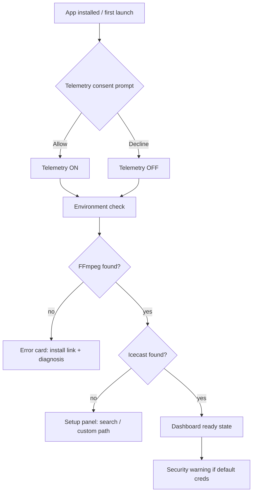
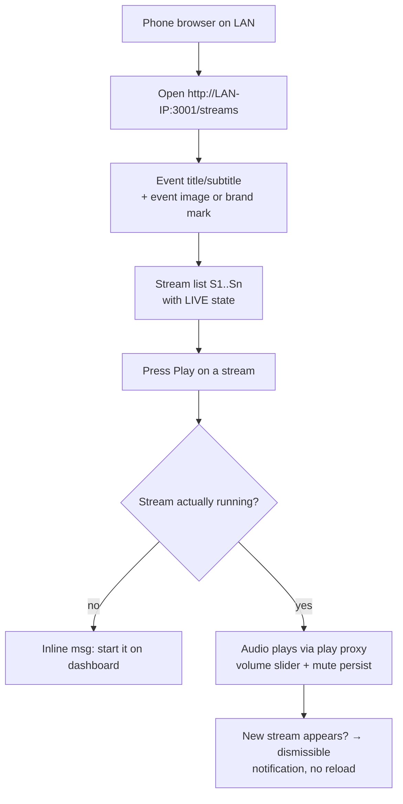
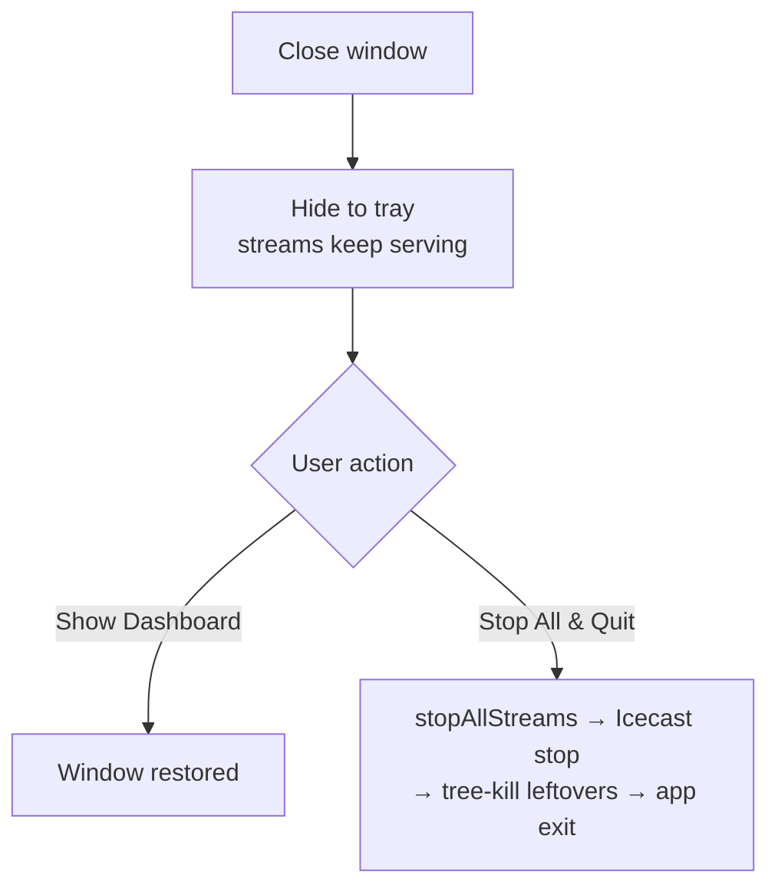

# LANStreamer App Flow

Purpose: single map of every page, user flow, and component — the source of truth for the UI redesign and for generating design prompts (Lovable/Nanobanana/Mobbin references). Last updated: 2026-10-28.

---

## 1. Pages

| Page | URL | Audience | Auth | File |
|------|-----|----------|------|------|
| Admin Login | `/login` | Operator | credentials → JWT | `public/login.html` |
| Admin Dashboard | `/dashboard` (also `/`) | Operator | localhost-only (`requireLocalhostAdmin`) | `public/index.html` |
| Listener Page | `/streams` | Anyone on LAN | none | `public/streams.html` |

The **Electron desktop app** (packaged) opens `/dashboard` in its own window on the operator's machine; listeners always use their phone/PC browser on the LAN. Same pages either way.

---

## 2. Primary flows

### 2.1 Operator: first run



### 2.2 Operator: start a stream

```mermaid
flowchart TD
    A[Dashboard] --> B[Click Start New Stream]
    B --> C[Add Stream modal]
    C --> D[Pick audio device / file]
    D --> E{Optional: Test Source<br/>(Show test tools toggle)}
    E --> F[Set name, quality, bitrate]
    F --> G[Click Go Live]
    G --> H{Capacity check<br/>Icecast running?}
    H -- no --> X1[Error: start Icecast first<br/>+ quick fix]
    H -- full --> X2[Error: source limit reached<br/>+ capacity context]
    H -- ok --> I[Device accessibility test]
    I -- fail --> X3[Device error + diagnosis modal<br/>(solutions, stderr, guide link)]
    I -- pass --> J[FFmpeg spawn → push to Icecast]
    J --> K[Stream card: LIVE badge,<br/>uptime, listeners, stop/edit]
    K --> L{Duplicate name/source?}
    L -- yes --> X4[Simple duplicate modal]
```

### 2.3 Listener: tune in



### 2.4 Shutdown (Electron tray mode)



---

## 3. Dashboard layout (current)

```
+----------------------------------------------------------------------+
| HEADER: logo | Icecast status pill | ffmpeg status | update bell    |
+----------------------------------------------------------------------+
| SECURITY WARNING (dismissible) — if default creds                    |
+----------------------------------------------------------------------+
| STREAMS CARD                                          | EVENT PANEL   |
|  toolbar: [Show test tools][Refresh][Start/Stop All]  |  (image,      |
|  stream rows: S1..Sn                                  |   title,      |
|   [LIVE badge] name | uptime | listeners              |   about)      |
|   [play/stop][edit][reorder ↑↓][delete]               +---------------+
|   empty state: Quick Start guide (dismissible)        | CONTACT &     |
|                                                        | FEEDBACK      |
| ICECAST CARD: start/stop, mounts, capacity            | (collapsed)   |
+----------------------------------------------------------------------+
| FOOTER: version | GitHub link                                        |
+----------------------------------------------------------------------+
```

## 4. Listener layout (current)

```
+----------------------------------------------+
| HEADER: logo | Listen to Streams link        |
+----------------------------------------------+
| Event title + subtitle                       |
+----------------------+-----------------------+
| STREAM CARDS         | EVENT IMAGE /         |
|  S1 [LIVE] name      | brand mark default    |
|  [▶ Play]            +-----------------------+
|  per-card: volume,   | ABOUT (default text)  |
|  mute                +-----------------------+
|  S2 ...              | CONTACT & FEEDBACK    |
|                      | (collapsed default)   |
+----------------------+-----------------------+
| FOOTER: version | GitHub | license           |
+----------------------------------------------+
```

**Redesign note (Mobbin + Stemtracks direction):** listener page should get a sticky bottom mini-player (Sonos/Spotify pattern) so controls survive scrolling; one dominant Play per card; LIVE = color + text, never dot-only.

---

## 5. Component map

| Component | File | Used by | Notes |
|-----------|------|---------|-------|
| FFmpegStreamsManager | `components/FFmpegStreamsManager.js` | Dashboard | stream CRUD, start/stop/reorder, modals, Test Source, Quick Start |
| IcecastManager | `components/IcecastManager.js` | Dashboard | start/stop, mounts, capacity, install search |
| EventManager | `components/EventManager.js` | Dashboard | event title/subtitle/about/image (persisted `config/`) |
| ContactManager | `components/ContactManager.js` | Dashboard | WhatsApp/phone/email shown on listener page |
| HeaderComponent | `components/HeaderComponent.js` | Both | logo, status pills, update bell |
| FooterComponent | `components/FooterComponent.js` | Both | version, links |
| UpdateNotification | `components/UpdateNotification.js` | Dashboard | GitHub release check |
| LobbyMusicPlayer | `components/LobbyMusicPlayer.js` | Dashboard | file-playback preview |
| FileBrowser | `components/FileBrowser.js` | Dashboard | pick input file |
| ComponentManager | `components/ComponentManager.js` | Dashboard | lifecycle orchestration |
| LSNotices | `assets/js/notice-dismiss.js` | Both | dismissible notices w/ Show stubs |
| StreamListener (inline) | `streams.html` | Listener | play proxy, volume, new-stream notif |

## 6. Backend services (context for redesigners)

| Service | Role |
|---------|------|
| `StreamingService` | FFmpeg spawn/lifecycle, formats (MP3/AAC/OGG), persistence, capacity |
| `IcecastService` | install detection, start/stop, stats (localhost polls), hostname auto-sync, security check |
| `AudioDeviceService` | device discovery (dshow; wasapi fallback) |
| `UpdateService` | GitHub release polling (to be replaced by electron-updater) |
| `TelemetryService` | PostHog, opt-in, anonymous ID, queue-and-flush |

API surface used by the UI: `/api/streams/*` (status, start, stop, start-all, stop-all, reorder, play/:id proxy), `/api/system/*` (config, icecast start/stop/status, audio-devices, security-check), `/api/settings/*`, `/api/contact-details`, `/api/auth/login`.
