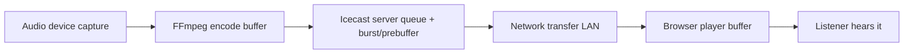

# Latency in LANStreamer

What affects the delay between the operator's audio and what listeners hear, and what can be done about it — split into what **we control** (app side) and what **the operator/event setup controls** (their side). Research date: 2026-10-28. References at the end.

## Where latency comes from (total = sum of all stages)

Encoder buffer + server queue + burst/prebuffer + player buffer dominate; the LAN network itself is usually < 5 ms.

## App side (what LANStreamer can do)

**Status 2026-10-30: the low-latency round SHIPPED.** Measured on a live stream (Chromium, `scripts/verify-latency.mjs`): buffered-ahead in the player dropped from **~2.3 s (browser default) to ~0.5 s steady**, time-to-first-audio ~1.6 s after the tap. Architecture floor with MP3-over-HTTP is ~0.8–1.2 s end-to-end; going below that means changing transport (WebSocket/WebRTC + Opus), not tuning.

| Lever | Status (2026-10-30) | Trade-off |
|---|---|---|
| **Listener player (the big lever)** | ✅ SHIPPED — MSE-based playback (`public/assets/js/lowlatency.js`): the page fetches the play-proxy stream itself and appends ~0.5 s chunks to a MediaSource buffer, snapping the playhead back to the live edge whenever drift exceeds ~0.65 s (rate-limited to 1/s). Safari/iOS (no MP3-in-MSE) and any MSE failure fall back to the plain `<audio src>` path automatically | Occasional tiny audible skip when snapping back to live after WiFi jitter — the cost of staying live instead of drifting seconds behind |
| **FFmpeg capture flags** | ✅ SHIPPED — `-fflags nobuffer -flags low_delay -probesize 32k -analyzeduration 0` before the dshow input, `-flush_packets 1` on output (both input paths). Validated live against a real VB-Cable capture | Validated on this machine's devices; exotic capture devices should be re-tested (regression test: `tests/integration/ffmpeg-spawn.test.js`) |
| **Express play proxy** | ✅ SHIPPED — `flushHeaders()`, `socket.setNoDelay(true)` (Nagle cost 40–200 ms per small MP3 frame), `Cache-Control: no-store` | — |
| **Icecast `burst-on-connect` / `burst-size`** | ✅ SHIPPED (bundled template) — burst stays ON with a 16 KB burst (≈0.7 s at 128k) instead of the stock 64 KB (≈4 s pre-pushed on join) | 0 would shave a little more but listeners take 1–2 s longer to first hear audio |
| **Icecast `queue-size`** | Stock 512 KB (it is a backlog CAP, not added latency — leave it) | — |
| **Bitrate / codec** | MP3 128–192 kbps stays the balance; Opus would cut ~0.1–0.3 s but Icecast+browser support is spotty | Lower bitrate (64–96 kbps) for many-listener events |
| **FFmpeg pacing (`-re`)** | Device capture is inherently real-time; `-re` only on the file-input path | — |

**Remaining idea (bigger rewrite):** WebSocket/WebRTC + Opus transport for ~200–400 ms — see the UX audit P4/deferred list; only worth it if same-room interpretation demands sub-second.

## Operator/event side (beyond our control — guide them)

From research on wireless audio latency (see references):

1. **Use 5 GHz WiFi** for listeners where available; 2.4 GHz is congested (microwaves, neighbouring networks).
2. **Router QoS**: prioritize the server machine's traffic; or better —
3. **Dedicated WiFi network / hotspot** for the event. A phone-hotspot or spare router purely for streaming beats a busy venue network.
4. **Wired where possible**: the *operator* machine to the router via Ethernet removes the biggest variable. Listeners are inherently wireless.
5. **Placement**: line of sight between listeners and the AP; elevate the AP; keep it away from microwaves/other transmitters; minimise distance.
6. **Limit listener count per AP** (~20–25 phones per consumer AP for audio); add a second AP on a different channel for larger events.
7. **Update firmware/drivers** on router and audio devices.
8. **Measure, don't guess**: latency-testing apps + watching for stutter tells you whether the problem is network (stutter, drops) or config (constant offset).

Constant ~1–3 s offset = buffering config (burst/prebuffer). Stutter/drops = WiFi capacity/interference. That distinction tells you which side to fix.

## References

- [Fixing streaming latency in wireless audio systems — TechTaps](https://techtaps.com/how-to-fix-streaming-latency-issues-in-wireless-audio-systems/)
- [Icecast config reference (burst-on-connect, burst-size, queue-size)](https://github.com/AzuraCast/icecast-kh-ac/blob/main/doc/icecast2_config_file.html)
- [Icecast Streaming Handbook](https://we.riseup.net/assets/29773/Icecast-Streaming-Handbook)
- [LibreTime: Icecast tuning discussion](https://github.com/libretime/libretime/issues/540)
- [Low-latency Icecast streaming thread (RTLSDR)](https://www.reddit.com/r/RTLSDR/comments/zwv0ut/low_latency_streaming)
- [FFmpeg to Icecast usage — ffmpeg-user list](https://ffmpeg.org/pipermail/ffmpeg-user/2019-June/044578.html)
- [Liquidsoap clock docs (source pacing)](https://www.liquidsoap.info/doc-dev/clocks)
