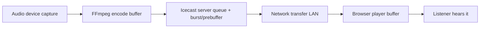

# Latency in LANStreamer

What affects the delay between the operator's audio and what listeners hear, and what can be done about it — split into what **we control** (app side) and what **the operator/event setup controls** (their side). Research date: 2026-10-28. References at the end.

## Where latency comes from (total = sum of all stages)

Encoder buffer + server queue + burst/prebuffer + player buffer dominate; the LAN network itself is usually < 5 ms.

## App side (what LANStreamer can do)

| Lever | Status / idea | Trade-off |
|---|---|---|
| **Icecast `burst-on-connect` / `burst-size`** | In our generated `icecast.xml`, set `burst-on-connect` to 0 for lowest latency | Burst makes playback start faster but ADDS initial latency; without it, listeners take a second or two longer to start hearing audio |
| **Icecast `queue-size`** | Keep small in generated config | Too small = stutter on WiFi jitter |
| **Bitrate / codec** | MP3 128–192 kbps is a good latency/quality balance; AAC has slightly higher encoder latency than MP3 at same settings | Lower bitrate (64–96 kbps) lowers encoder buffer + network load when many listeners |
| **FFmpeg pacing (`-re`)** | Our spawn paces capture in real time already (live device input) | — |
| **FFmpeg capture flags** | Evaluate `-fflags nobuffer -flags low_delay`, smaller `-probesize`/`-analyzeduration` for capture-side savings | Risk: some DirectShow devices misbehave; needs per-device testing |
| **Listener player buffer** | Our `<audio>` play proxy uses browser defaults; investigate `preload="none"` (already set) + short fetch-buffer tricks | Browsers resist tiny buffers (stutter protection) |
| **Express play proxy** | Streaming proxy adds negligible latency (no buffering, pipes bytes) | — |

**Candidate TODO:** generate `icecast.xml` with `burst-on-connect 0` and measure end-to-end latency (clap test: record operator clap + phone output, count frames) before/after.

## Operator/event side (beyond our control — guide them)

From research on wireless audio latency (see references):

1. **Use 5 GHz WiFi** for listeners where available; 2.4 GHz is congested (microwaves, neighbouring networks).
2. **Router QoS**: prioritize the server machine's traffic; or better —
3. **Dedicated WiFi network / hotspot** for the event. A phone-hotspot or spare router purely for streaming beats a busy venue network.
4. **Wired where possible**: the *operator* machine to the router via Ethernet removes the biggest variable. Listeners are inherently wireless.
5. **Placement**: line of sight between listeners and the AP; elevate the AP; keep it away from microwaves/other transmitters; minimise distance.
6. **Limit listener count per AP** (~20–25 phones per consumer AP for audio); add a second AP on a different channel for larger events.
7. **Update firmware/drivers** on router and audio devices.
8. **Measure, don't guess**: latency-testing apps + watching for stutter tells you whether the problem is network (stutter, drops) or config (constant offset).

Constant ~1–3 s offset = buffering config (burst/prebuffer). Stutter/drops = WiFi capacity/interference. That distinction tells you which side to fix.

## References

- [Fixing streaming latency in wireless audio systems — TechTaps](https://techtaps.com/how-to-fix-streaming-latency-issues-in-wireless-audio-systems/)
- [Icecast config reference (burst-on-connect, burst-size, queue-size)](https://github.com/AzuraCast/icecast-kh-ac/blob/main/doc/icecast2_config_file.html)
- [Icecast Streaming Handbook](https://we.riseup.net/assets/29773/Icecast-Streaming-Handbook)
- [LibreTime: Icecast tuning discussion](https://github.com/libretime/libretime/issues/540)
- [Low-latency Icecast streaming thread (RTLSDR)](https://www.reddit.com/r/RTLSDR/comments/zwv0ut/low_latency_streaming)
- [FFmpeg to Icecast usage — ffmpeg-user list](https://ffmpeg.org/pipermail/ffmpeg-user/2019-June/044578.html)
- [Liquidsoap clock docs (source pacing)](https://www.liquidsoap.info/doc-dev/clocks)
